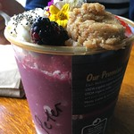
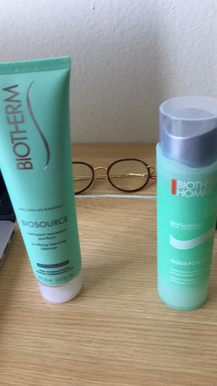
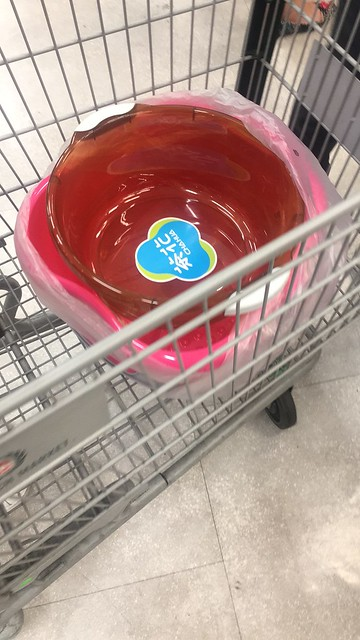
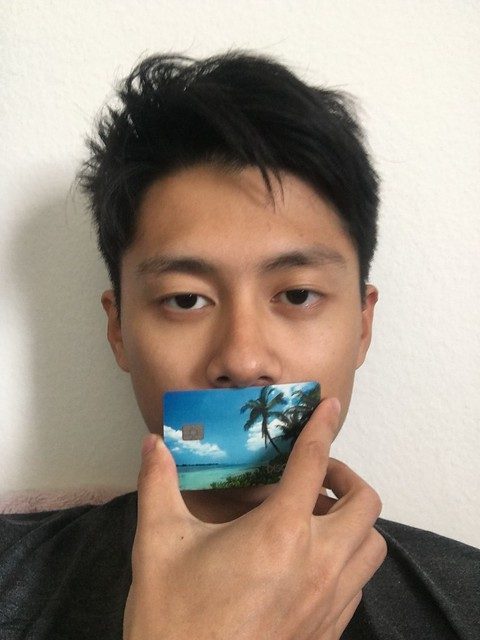
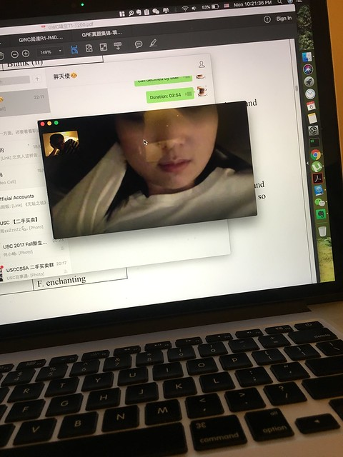
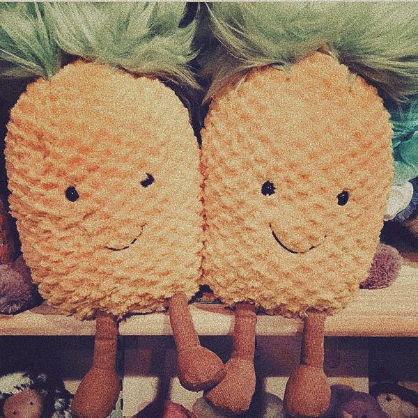

真的没有想到在我们第500天的时候吵的这么凶，就像你说的，我们现在在对方眼里已经不是之前的自己了。我之前一直认为两个人的感情越来越趋于稳定说明两个人更会信任，包容，理解对方，所以这些鸡毛蒜皮的小事都不会互相计较。那段时间我活的很迷糊，也很简单，因为我以为不再需要像以前那样慢慢沉淀，累计，然后往前走。我以为的一切都是那种水到渠成，根据自己的内心就可以走向终点。

但是我们这次的吵架居然还是为了一件鸡毛蒜皮的小事，而且没想到能持续的这么久，说实话，我也不想这样吵下去，也许真的是时候作出一个决定来为我们各自的人生负责了。

那你还记得这张照片么？

难道以后我要把我们从hollywood买的butter全部都扔掉了吗？凭什么？！

那你还记得这张照片么？

难道我要把我唯一用的护肤品全部都扔掉了吗？凭什么？！

那你还记得这张照片么？

这个脚盆是当时专门从中国城买的，我当时看到的时候都快开心的蹦起来了，我不怕丢脸（因为真的没有人会无缘无故买一个粉色的洗脚盆带回一个男生宿舍）带回家，就为了让你不要在来大姨妈的时候那么痛苦，难道我干的这些都是白费了吗？凭什么？！

那你还记得这张照片么？

你一定还记得我们用这张信用卡照的照片发给warby parker去测瞳距吧！难道我就只能把这个没戴过两三次的眼镜直接扔掉了么？凭什么？！

那你还记得这张照片么？

你还记得上个暑假我在palo alto实习，我们白天在家微信视频，同时还一起准备gre的那段时间吗？我们费尽周折想可以一起看电影，但是视频电话的声音调了好久都没调好。你又有多知道我很庆幸当时我们吵架，因为这样我们就可以提前一点点见到对方，我当时有多么的激动么！这些日子都见鬼去了么？！

我们的小菠萝，我们的一切，我们的未来，难道都因为这一次吵架变得失去了所有的意义了吗？难道爱就是这么的残酷无情？！

我不能接受，不光是因为我不能接受我会失去这些所有的一切，我想更多的是我对你的爱实在太深，我没办法离开你了。对不起，小冷，请你知道我对你的爱。即使我是那么的不然言辞，只能用这些乱七八糟的照片去告诉你我的想法，但是我真的爱你，对不起。

沉淀这种东西原来真的只有慢慢成熟的人才会理解，我不知道我理它还有多远，但是未来的路，我还是希望有你。

--Haoyang
