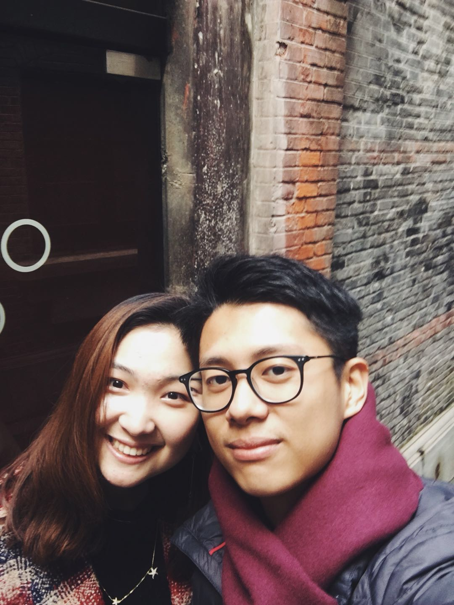
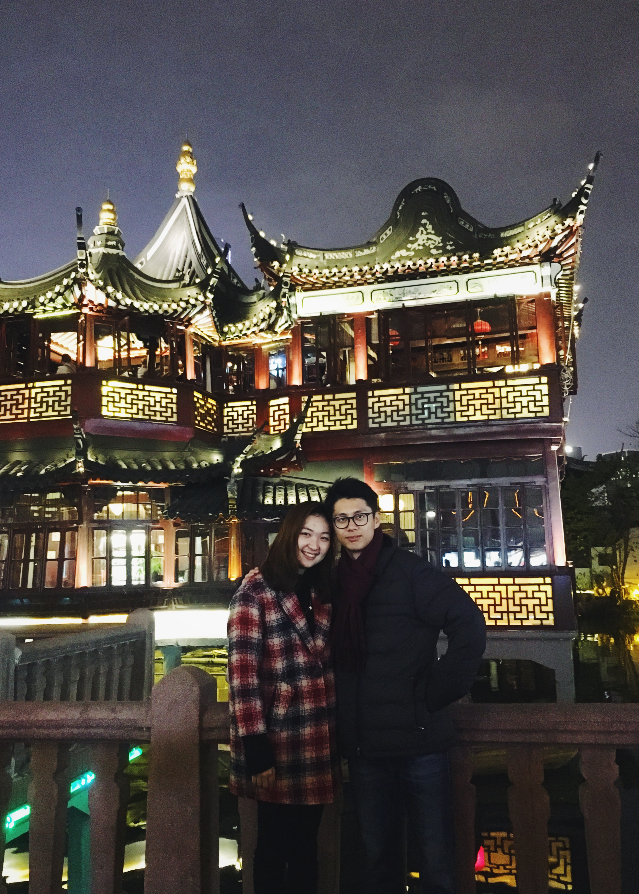
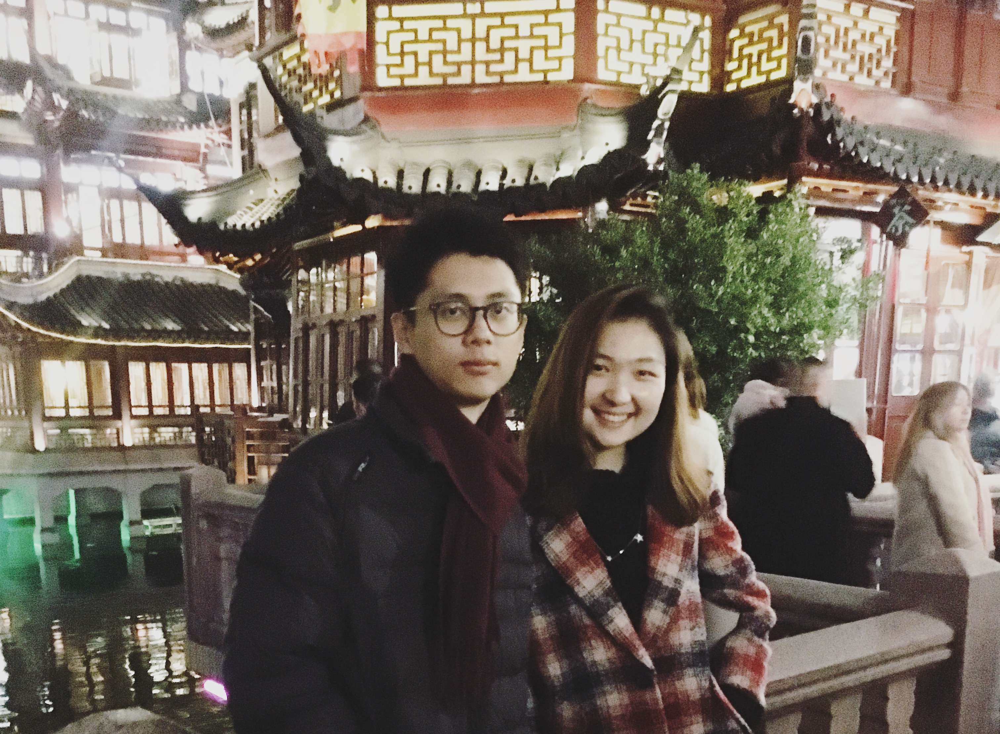

上海真的是一个美丽的城市，虽然这是我最近第二次来到上海，她的惊艳依旧丝毫不减。当然她的美不仅仅是因为那高耸如云的上海中心大厦，或者热闹的外滩，更重要的是这次在这里的一个人。

坐完了四个小时的高铁，与北京不同的温暖便扑面而来。不记得是我先看到的小冷还是小冷先看到的我，我们在出站口终于结束了之前长达半年多的“网友”关系，我激动也很高兴的第一次这么心动的抱住了一个女生，根本不想分开。我们的见面就这样开始了，在之前我脑海里排练的一幕幕都变得清晰起来，但是却有有一些陌生。

我很惭愧，第一次牵手我居然久久迟疑到小冷尴尬的问我。希望小冷可以原谅我的这份胆怯，也感谢你可以这样告诉我你的感情是那么的真实可见。我还记得第一天晚上看完电影送你回家时的场景，虽然有千万的不舍，但是我也很能感受到我们的心在砰砰的一起乱跳，我相信这段真实却又不留痕迹的爱从那个时候就变得越来越成为了一种习惯。

*我们在一个弄堂里第一次贴的这么近的合影，心里暗爽了半天*

不知道是谁先着凉，我们第二天中午之后就感冒了。还记得那个老爷爷老奶奶的故事，在大森林里迷路了，却依旧找到了心爱的那个人。我当时比较严重，加上时差的缘故，带着晕晕呼呼的脑袋就跟你去了新中关逛街。我很高兴你的成熟和调节情绪的那种独立性，也相信在未来不管别人如此的否定我们都会责无旁贷的信任对方，我们需要的只是时间来检测这段感情，并且我很相信我们可以做的很好。

*后来我们去了豫园，比想象中的人要少很多，不过也可能是因为我们去的比较晚*

*同上一张的豫园，但是这张我的表情总是给人在生气的印象，但是真的这只是错觉，从此以后下决心练习微笑*

我一直很难相信我可以如此幸运，在这么如此浮躁的世界认识一个这样的小冷。我们的这次约会没有那么惊天动地，而更多的是细水长流的随性。换句话说，我们都没有刻意想要做什么，而是仅仅期待着一切的发生。这次见面印证了我之前对小冷的认识，介入到了她的生活，这是多么需要勇气的一件事！但是我更加喜欢这样的小冷。

--Haoyang
