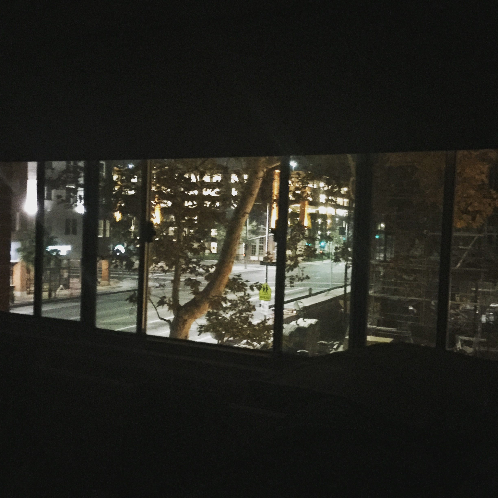
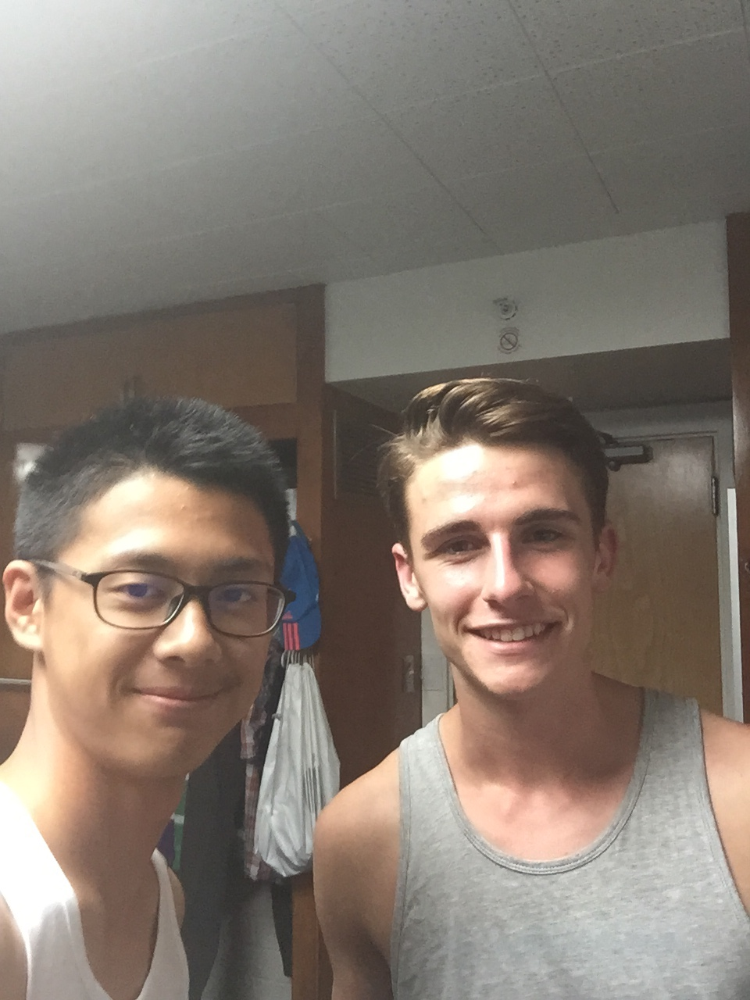
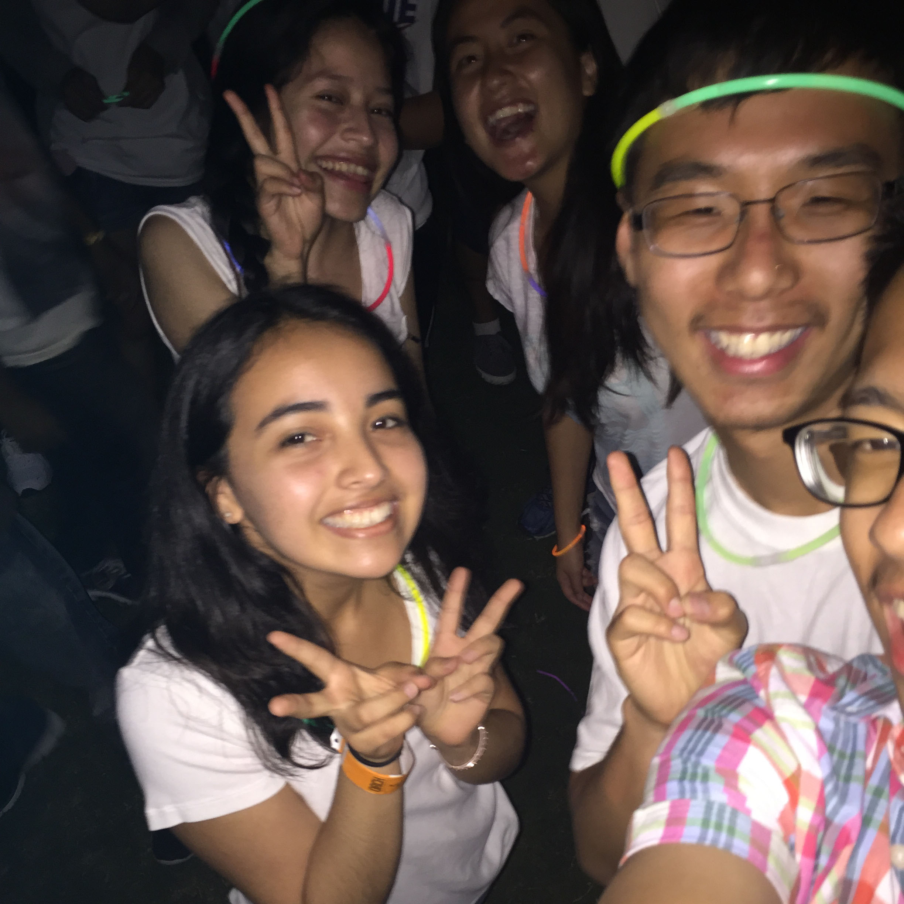

>也许这就是生活吧

## 是的，北京下雨了

没有想到北京的夏天就这么悄无声息的到来了，没有一丝犹豫。直到今天早上踏出家门的第一步起我才发现雨天的北京其实比想象中的要美。

## 雨中

我一直不是个喜欢下雨的人，从小到大都是这样。因为我忍受不了淋湿的痛苦，交通的不便，更关键的是内心的浮躁。

让我想起了在刚刚抵达美国的那天，和现在一样一个人待在自己的房间里，只听得到窗户外面的淅淅飒飒的雨声。

*于2015-8，在入学之后*

我住在学校的最东南角，距离马路相隔不到50米，对面的是在修建的教学楼。我的国内的朋友们都没有选择住在这个楼里面，于是天然的我被隔绝在自己的小世界里。在从北京飞往洛杉矶的旅途中我也只是零零散散认识了一些朋友，由于不善交际，在入学初也吃了不少亏。

后来我见到了我的室友Raphael Danilo.说实话，第一次自己出去住并且还是和一个很帅的同学作室友是一个很自豪的事情，加上总是一个人待在房间里也希望找一个可以一起说话的人。抱着种种期待，我的大学第一年就开始了。

*于2015-8，搬到宿舍之后的第三天*

然而很多事情不是。每天上完课后只有无所事事的懒散，加上社交的很多顾虑，我也没有认识很多朋友。开始我以为这对我来说并不是痛苦的事情，因为从初中开始我便知道自己不是拥有强社交能力的人，更多的能量来源于自己，这可能有家庭的因素，但是我恐惧把自己剖析的体无完肤。

但是渐渐的我发现我的内心并没有想象中的强大，当自己一个人每天早上去食堂吃饭的时候看到只有我一个人木木的坐在偌大的方桌前不知所措，我发现我的内心其实还是渴望那些我一直没有的东西。于是我便开始尝试跟人打交道，尝试给自己一个借口来说服自己改变自己。后来我便认识了第一个，也是后来我最要好的朋友之一Terence Zhang.

*于2015-8，学校给新生办的party，在我后面便是Terence*

我还记得我们是在Orientation上认识的，但是之后有一段时间断了联系，直到后来我在图书馆偶遇，他邀请我一起跟他学习我们才发展成非常要好的朋友。Terence是美国人，但是中文也很流利。他从小在上海长大，辗转国内国外的很多城市，经历了很多一般人经历不到的事情，对于他来说，我的生活应该是非常枯燥无味。Terence有很多的朋友，但我只有他一个朋友，很多时候我都很尴尬的站在他们中间不知所云。这其中不乏有语言的，措辞的各种情商问题，我也一直想提高自己的，但是却一直弄巧成拙。后来我放弃了，我发现我永远也做不了像他一样的人。有时候也问他是不是觉得我说话的方式有问题，他也很诚恳但是礼貌的跟我解释为什么别人会觉得我很awkward。后来我才直到我问他的这些并不是想要得到一个确切的答案，只是想从别人的角度来看我自己罢了，即自私又无聊。

后来Terence认识了Cherry。Cherry的到来让Terence有点措手不及，因为Terence真的很喜欢她，但是他们之间总是吵架。对于Cherry来说这是她的初恋，然而Terence并不是。以前总有一句话说“最怕恋爱中的女人比男人要更加成熟”，现在看来要加一句“反之亦然”。作为朋友，我一直很支持Terence，因为有的时候其实矛盾的瓦解只是需要一个契机而已，我很希望可以作为那个契机。

然而今年，他们还是分手了。这次我没有细问究竟发生了什么，但是我知道Terence一定有自己的难处，也许他们真的不够幸运吧。Terence做的很多事情其实我是不能接受的，比如说我们一起参加Hackathon，他一直找mentor问问题，甚至直接让他们帮助写码；为了找工作宁可不要自己的身体也要与各种人社交。作为一个看起来有点自闭的人，这些我其实都十分的拒绝。然而作为朋友，我会永远的支持他，因为我相信一切的不幸发生在我的身上他也一定会这么想的。

再后来，我还是认识了一些人，有一面之交的，有直到现在还保持联系的，我便想，从认识Terence的那一天起便是我在等待的那个契机吧。

## 雨后

这个暑假Terence成功申请到在微软总部的实习，作为大二的学生便可以去这么大的公司实习足以证明他的不凡。我们联系渐少，大家都在忙，为了未来和理想。

现在的我更多的时候也不再给自己找借口，更多地做自己想做的事情，可能这样或者会很累，但是我觉得会比永远在一瓢清水的细沙会更有意义，内心的恐惧我相信也会慢慢消失殆尽。

雨后的北京迎来了夏天中短暂的凉爽，在寂静的夜里睡去，希望做个美梦。

--Haoyang
