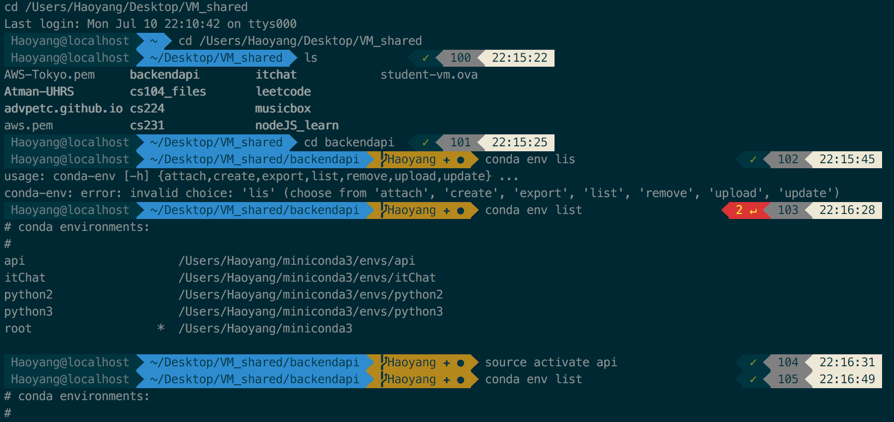

>以下基于Linux系统

## zsh简介

在写程序的时候很多时候要会使用shell操作一些命令，因此有一个比较好用的terminal十分重要。像最基本的在执行命令时自动填充(autocomplete)到显示git repo的branch位置等高级的操作都是日常必需的功能。苹果自带的terminal用的是bash shell，很多功能都已经涵盖，但是还是有很多改进的地方，所以zsh的到来为更多的开发者提供了一个更加可自定义的平台，也因此拥有了很多炫酷的功能。

献上一张目前的shell的截图：


## 设置

参考[Github](https://github.com/robbyrussell/oh-my-zsh)上的开源项目进行设置。这个项目目前已经有了55000+的star，如果有兴趣一定不要忘记star，不管现在用不用的上，迟早你会发现它很有用。下面简单地讲一下如何设置。

### 安装

在安装之前首先要确定自己安装了**git**，通过使用
```bash
git --version
```
来查看是否安装，如果没有安装请参阅[Git官网](https://git-scm.com/downloads)

**通过curl**
```bash
sh -c "$(curl -fsSL https://raw.githubusercontent.com/robbyrussell/oh-my-zsh/master/tools/install.sh)"
```
**通过wget**
```bash
sh -c "$(wget https://raw.githubusercontent.com/robbyrussell/oh-my-zsh/master/tools/install.sh -O -)"
```
在下载完之后会出现一个确认界面，输入yes就可以了。

### 自定义
**Plugin**

zsh拥有很多plugin，在下载之前的配置文件中已经自带了一些官方的plugin，但是要在设置环境变量的文件中设置才可以，使用你最喜欢的editor编辑
```bash
vim ~/.zshrc
```
*我使用的是vim*

进入之后编辑Plugin部分
```
# Which plugins would you like to load? (plugins can be found in ~/.oh-my-zsh/plugins/*)
# Custom plugins may be added to ~/.oh-my-zsh/custom/plugins/
# Example format: plugins=(rails git textmate ruby lighthouse)
# Add wisely, as too many plugins slow down shell startup.
plugins=(git, npm, osx, zsh-autosuggestions)
```
*除了git（本身就会添加）之外，我还加了npm, osx, zsh-autosuggestions（之后会说明如何添加第三方Plugins）*

添加你喜欢的plugins，官方的plugins可以从[这里](https://github.com/robbyrussell/oh-my-zsh/wiki/Plugins)在这里推荐一下[zsh-autosuggestions](https://github.com/zsh-users/zsh-autosuggestions)，这个repo里面有详细的安装指南，在此不赘述

**Theme**

然后就是最有趣的地方--设置theme。打开.zshrc
```bash
vim ~/.zshrc
```
可以看到系统自己已经设置了一个主题
```
# Set name of the theme to load. Optionally, if you set this to "random"
# it'll load a random theme each time that oh-my-zsh is loaded.
# See https://github.com/robbyrussell/oh-my-zsh/wiki/Themes
ZSH_THEME="robbyrussell"
```
如果想切换成官方的主题可以直接更改就可以了，zsh提供了很有意思的random的主题的功能，只要改成**randon**就可以了，其他请见[Theme](https://github.com/robbyrussell/oh-my-zsh/wiki/themes)

但是有些时候如果使用自带的font会出现乱码的情况，所以在这里提供一些支持的font的[资源](https://github.com/powerline/fonts)，我的建议是直接git clone下来然后通过看每一个font的预览图来决定下载哪一个，如果是OSX直接双击即可安装完成。如果想要安装所有的font直接使用就可以了。
```bash
./install.sh
```

下面讲一下设置font。在OSX自带的bash terminal中点击 **preference** 或者 **command,** 打开偏好设置。在Profile下选择font，然后根据自己的喜好选择即可。
不过我个人推荐使用iTerm，它的用户体验更加完善，通过[Homebrew](https://brew.sh/)下载brew，然后输入
```bash
brew cask install iterm2
```
完成下载，在Launchpad中就可以看到iTerm的图标了，之后就是跟bash terminal设置同样的步骤，选择profile的font更改，在这里放一个整合iTerm与zsh的[Gist](https://gist.github.com/kevin-smets/8568070)

## 总结与注意

在使用bash的时候你可能会在**.bash_profile**中添加一些环境变量，千万不要忘记在zsh中也要添加，我之前忘记添加Anaconda的变量导致无法使用命令，希望大家不要犯这样的错误。总体来说zsh是一个不错的小工具，在使用的时候带来了很多便捷的地方，也给了用户很多自由的发挥空间来设置，我觉得它与[Atom](https://atom.io/)（虽然这两个没啥关系吧😄）的理念相一致，这样完全开源的项目我想也会是未来的趋势。

-Haoyang
