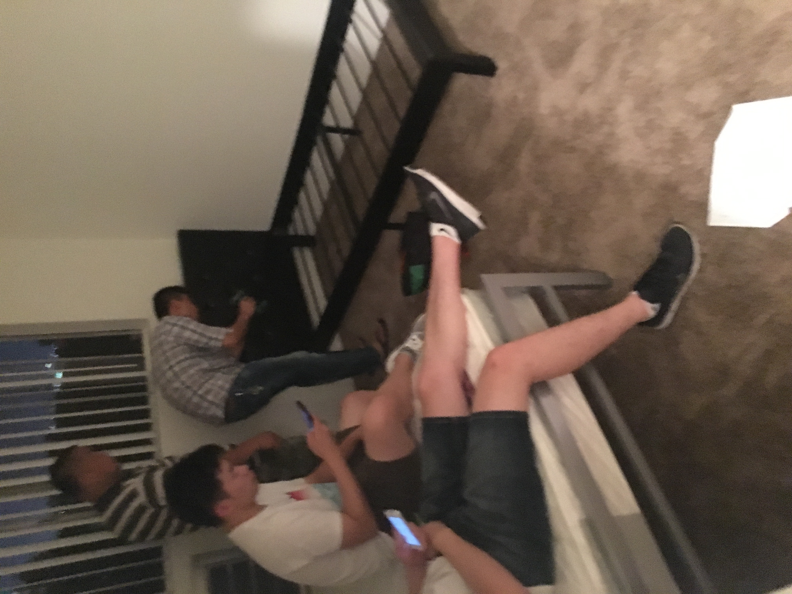
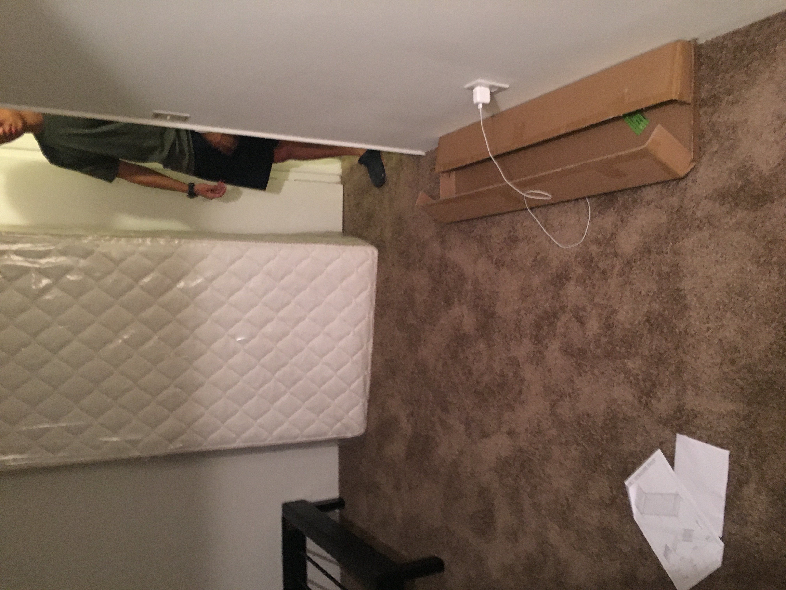
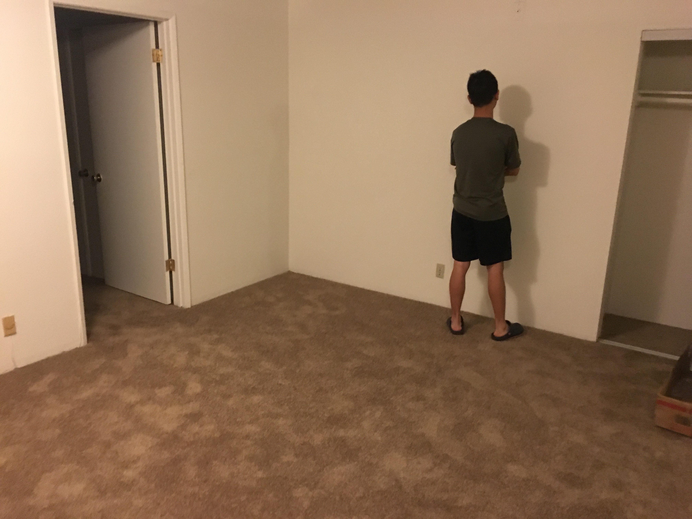
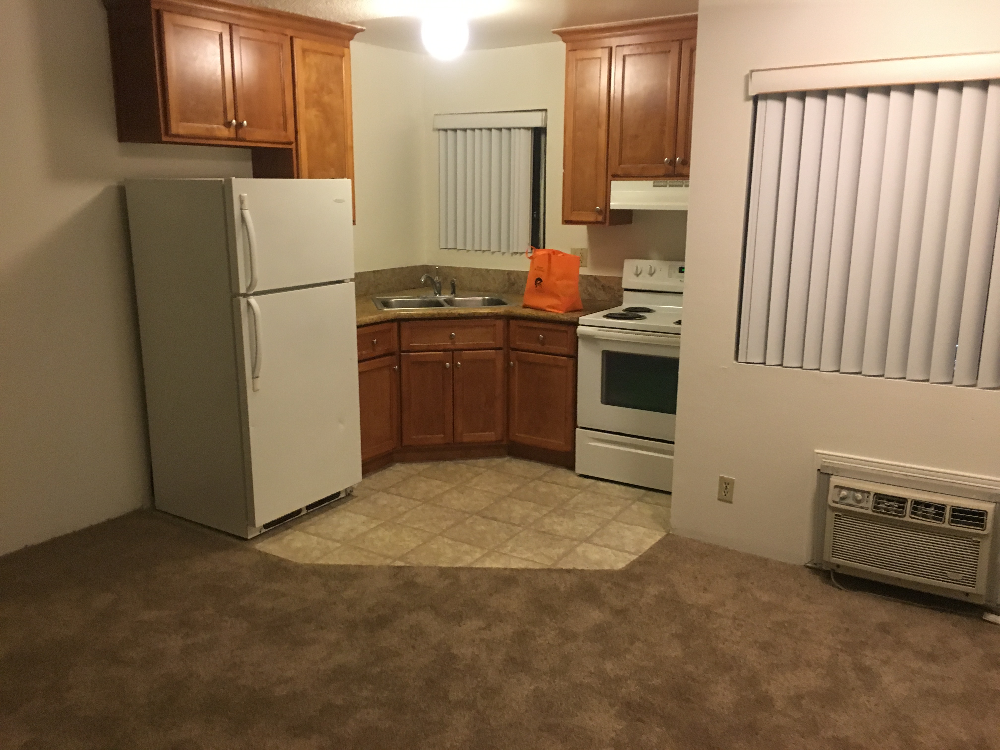
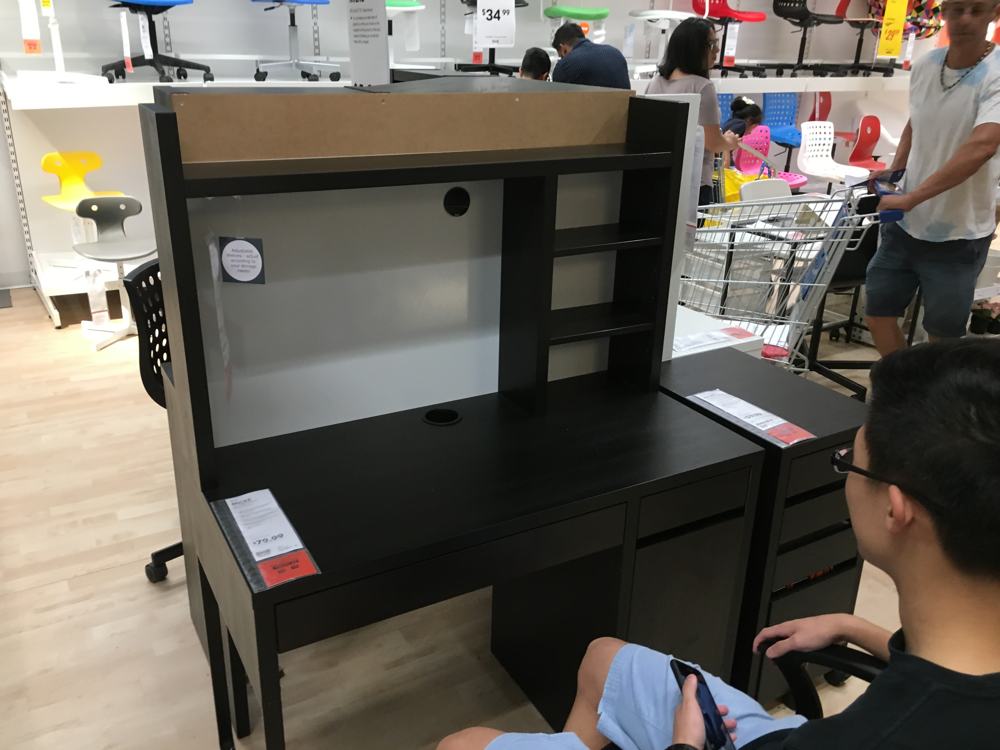
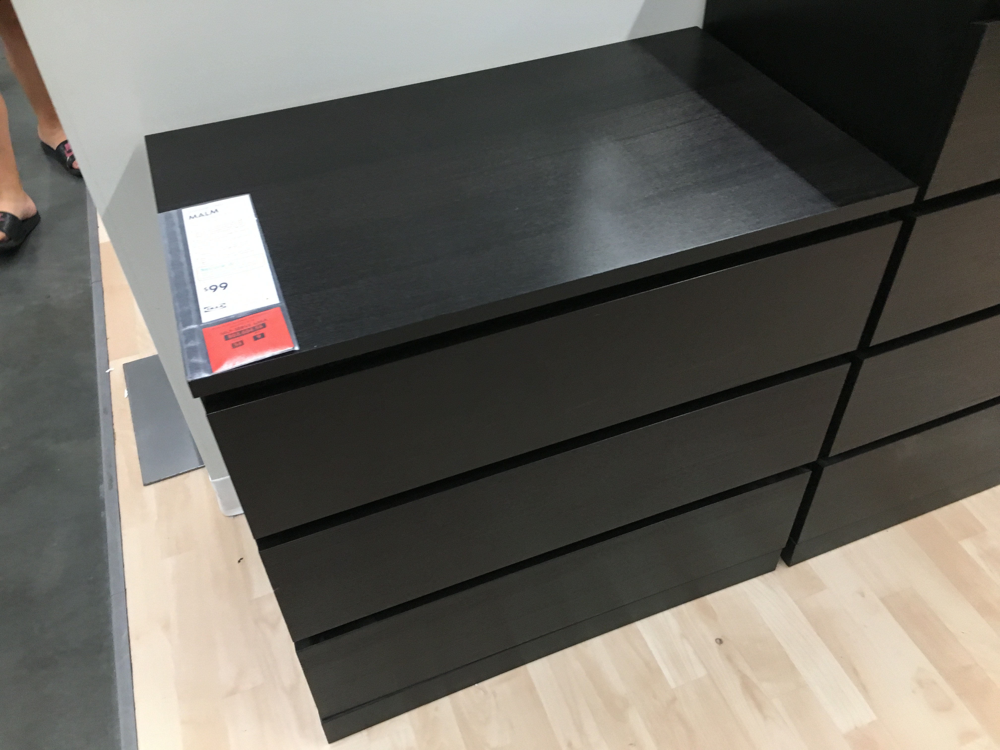
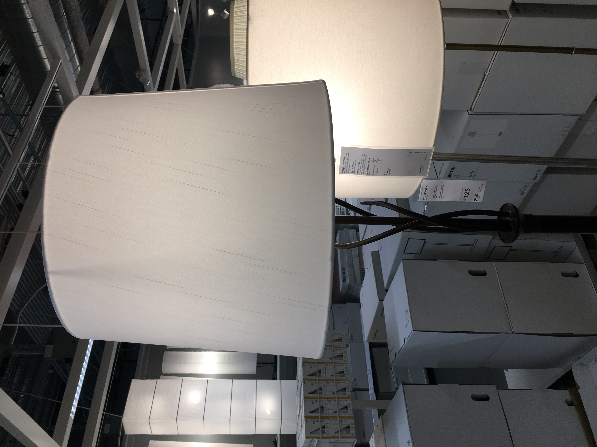

>激动人心的搬家

## 落地第一天

从北京飞到香港花了大约花了4-5个小时，加上北京下雨和各种延误一共花了大约6个多小时。在飞机上一直坐着很难睡着，于是就一直保持这半睡半醒的状态抵达了洛杉矶。刚刚落地的瞬间我居然感到了一种回到家的感觉，虽然自己真正的家远在万里之外，但是这种莫名的亲切感还是突然让我感到很踏实。这次回来和之前不太一样，因为我决定自己跟朋友搬到校外来住。一方面考虑到校外的租金会相对便宜一些，一方面考虑自己说不准能在暑假找到实习机会，于是只是短租显然不是个明智的决定（学校的租房只可以短租一个学期，summer不提供住房）。但是这样搬出来也同时带来了不少麻烦事，比如买家具，装家具等都是要考虑的问题。同时我是我们宿舍第一个到的人，所以所有事情都要先自己安排好，说实话还是很担心自己能不能做好这些。

*刚到自己的新租的宿舍之后第一感觉就是“好小啊，要不要考虑自己搬出去住呢？”。*

*客厅是所有房间中最大的区域，但是对于四个人住来说还是很小*

*厨房*

之前在国内找了一个当地的家具公司的人，他答应我在到的第一天就把床搬过来然后装好，争取让我第一天到了就有床睡。但是由于各种原因我第一晚还是寄宿在朋友家，毕竟自己住在一个空荡荡的房子里有点不太适应。不过还好，幸好洛杉矶这边有很要好的朋友，不然真的说不好第一天我会怎么样。

## 入住之后

我是8/16抵达的洛杉矶，学校开学在一周之后。本来打算用这段时间把家具什么的都买了安装好，但是迫于时差还有自己比较懒的原因一直都拖着没有完成，倒是和朋友们聚在一起吃了几顿饭。特别怀念洛杉矶的豆腐锅和人参鸡汤，于是就在这几天吃了个遍，倒是没挨饿。

然后陆陆续续我的室友们就都回来了。James是我的同房室友，他在洛杉矶有一辆车，于是在抵达之后我们就一起去了他存东西的地方拿回来了他的车。在有车了之后感觉方便了许多，可以说时间安排更加自由了。但是我们俩说实话都比较懒，于是家具还是没有及时买（毕竟有了床就可以找个地方舒服的躺下来了，于是别的就也没多想了），直到最后开学前一天我们才真正动身去了一趟ikea买了书桌个柜子等。光搬回来这些东西就感觉很辛苦。

*我们最后决定一起买一套很小的组合书桌，配了一把椅子和一个移动小柜子*

本来我们打算找之前找的家具公司的人来帮我们安装，可是不知道什么原因突然没办法联系他们，于是我们就自己找了一个组装家具公司。不过总算是弄完了这些琐碎的事情，以后再搬家相信也会更有经验了吧。

## 学校

然后就开学了。说实话我还是很期待这学期的课业内容，这个暑假对我来说就是希望提前了解一下我要在这学期接触的东西，所以还是很激动。

我的第一节课是周一上午11点的算法课，教授是获得过图灵奖的Adleman, Leonard，据说就是RSA加密算法中的A.然而第一节课只是简单了讲了讲算法和计算机的历史，总体来说还是有点失望。其他的课我都比较满意，教授都是很nice的人，但是同时也能感觉到压力，毕竟不是那个刚刚入学的大一新生了，有很多不得不面对的问题。

后来我和上学期的室友Eric见了面，甚至一起去尝试了一节Ball Room Dancing的课（顺便说一句，这个课的漂亮姑娘实在是超级的多）.回忆起之前的记忆还是很美好的，但是没办法，他的家在San Jose，所以每个假期一定要回家，也就是说不会像我一样长租房子。不过以后见面的机会还很多，希望这份友谊可以一直保留下去。

也和Terence见了面，不过感觉他跟之前变化很大，渐渐有些疏远。这时我又感觉出有些事情并不能强求，有些事情也不是永恒不变的。

总之在这段时间里见到了想见的人，做了想做的事情，算是经历了一些有意思的经历。希望这预示着一个好的开始。

--Haoyang
