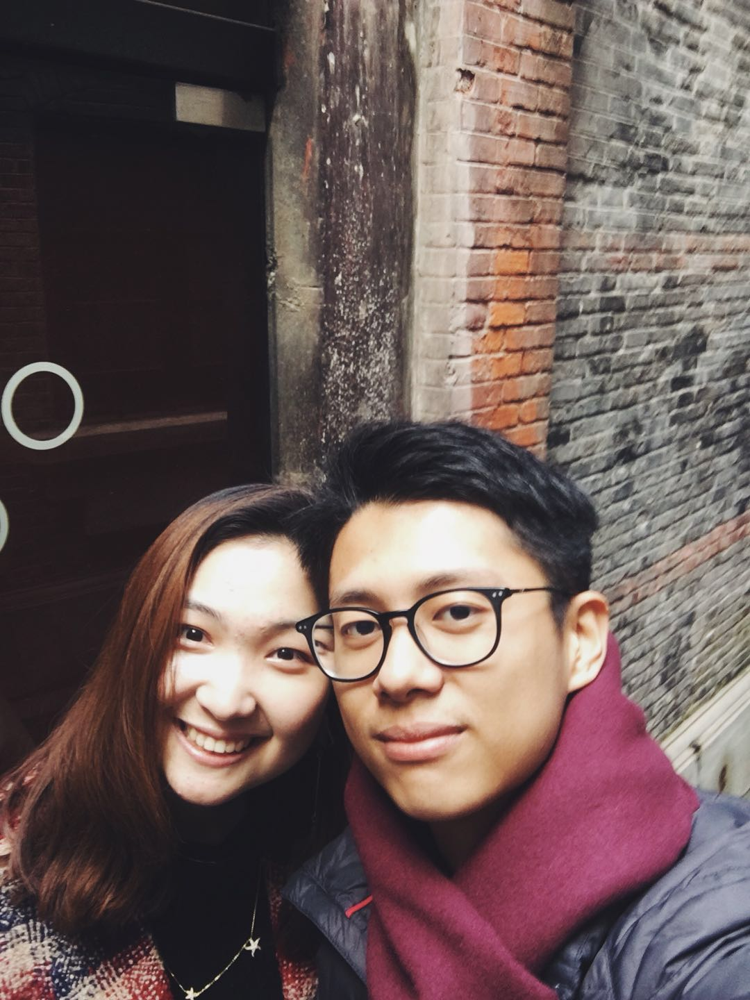
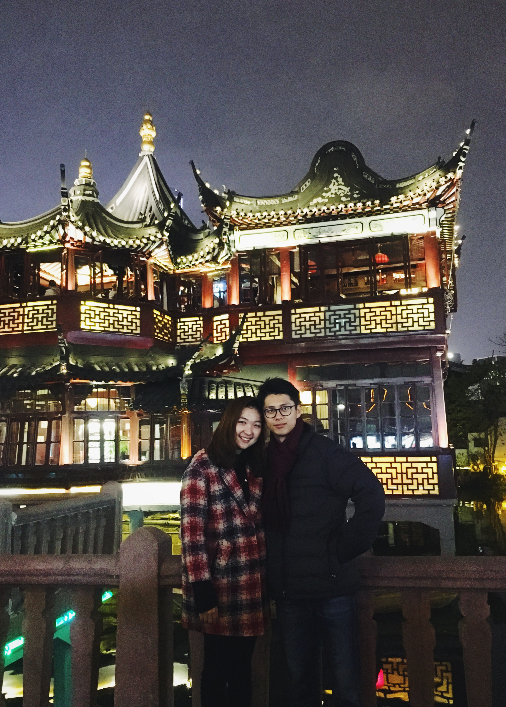
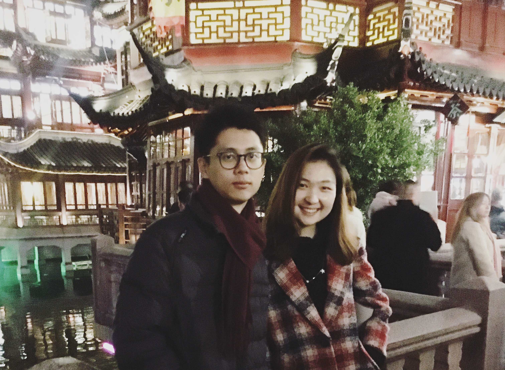

感情是有趣的。这个有趣很大一部分是来自于不确定性。不确定性起于那个未知的人，过往二十年里我构想期待过无数次将会与我并肩而行的那个人的模样，但想了快二十年，都没总结出所谓“理想情人”的标准，直到现在才真正体会到韩寒译的那句“遇上方知有”，这场相遇兜兜转转反反复复两年多，前三分之二的时间里我都无比坚定地相信我们的人生是两条平行线，后三分之一的时间我终于抛下了偏见放弃了过度分析，交给了感觉，然后… 我发现他真的不是一个多耀眼的人，他真的不是一个多会跟人聊天的人，他也真的不是一个多热情多开朗的人，总而言之他不符合普世价值观里对于“受欢迎”的定义。可是，我越接近越喜欢。他不耀眼，但他会找一个特别烂的借口送我一颗特耀眼的星星；他话又少又不会跟人聊天，但是他原创的小男孩小女孩还有老爷爷老奶奶的故事，我已经听了好几个版本了，因为我爱听故事；他不热情不开朗，但现在的他在我面前再无内敛可言，困到开始对着我撒娇说胡话，也不让我挂电话；他对我从来不吝啬感情的表达，第一次听到“我想你了”的我还心跳加速小鹿乱撞，然而高频率使我现在听到“我想你了”无异于听到“你吃饭了吗”😂。

*我们在一个弄堂里第一次贴的这么近的合影，我(Haoyang)心里暗爽了半天*

他不是一个绝对的理想恋人，但他对我来说就是最好的恋人。他不喜欢很闹很吵，我也不喜欢很闹很吵，我们觉得两个人安安静静呆着其实就很幸福；他喜欢想事情，我也喜欢想事情，所以我们可以一起发呆；他之前写下的blog是想给我看，我现在在写的blog是想给他看；他喜欢提前规划，我喜欢跟着感觉来，所以需要规划的事情都交给他，可以随心的事情都听我的；他爱分析不爱分享，我又爱分析又爱分享，这个他得听我的，必须分享；他希望我们的感情是成熟的，可以腻歪可以独立，这个我听他的。我们希望不纠结不争执，跟他有意见分歧的时候我都先自己冷静，然后再跟他商量；心里有小情绪的时候，我不会瞒他，会把所想的写成一段长长的话发给他，因为我知道他会很认真地看，然后很认真地回复。

*后来我们去了豫园，比想象中的人要少很多，不过也可能是因为我们去的比较晚*

生活不是数学题，没有那么多答题标准和正确答案，其中感情尤甚。我至今都无法概括出我的“理想情人”的标准，但当你跟我十指相扣走过很多条街，看完一整场电影，我们紧紧拥抱能听见彼此心跳，你哄着我喝完感冒冲剂，我就确定了，就是你了。

*同上一张的豫园，但是这张我(Haoyang)的表情总是给人在生气的印象，但是真的这只是错觉，从此以后下决心练习微笑*

他真的很喜欢你 像风走了八千里
他真的很喜欢你 所以他把你捧在手心
他真的很想念你 无时无刻不在想你
他真的很喜欢你 像第一首诗不尽人意

她真的很喜欢你 像春雨下得淅淅沥沥
她真的很喜欢你 像夏日聒噪的蝉鸣
她真的很想念你 像秋叶落得悄无声息
她真的很喜欢你 像冬天的雪沁在心里

--Leng
