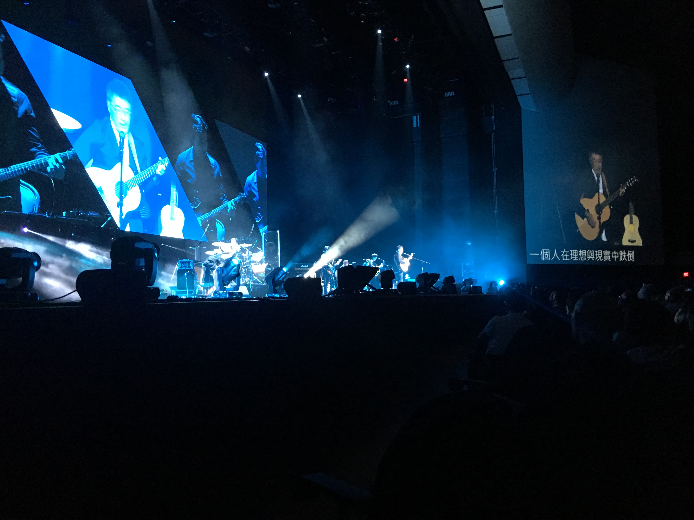
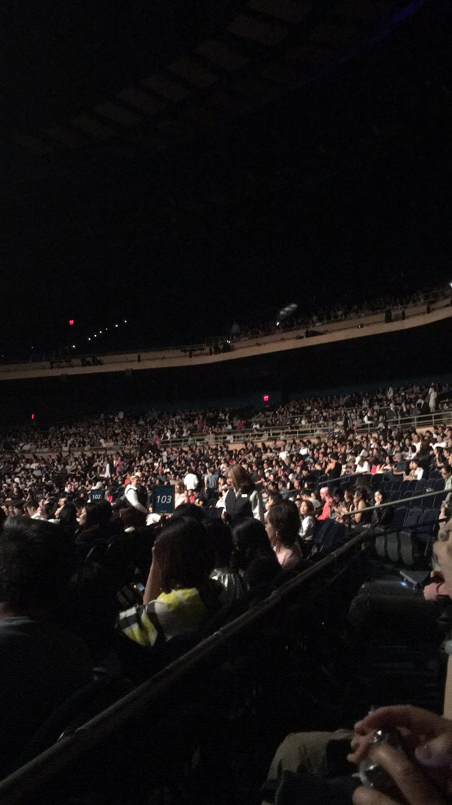
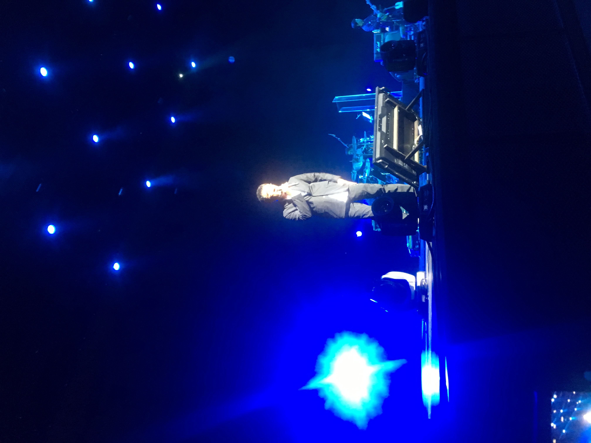
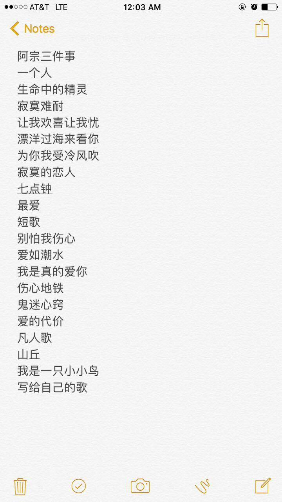

> Vegas之旅

## 演唱会

59岁的李宗盛大哥开始了美国的巡演，第一场在赌城Las Vegas，时间是9/9晚上九点。很难想象这么大年纪的阿宗还能在舞台上像年轻的歌手一样热情奔放。作为一个小歌迷，我很幸运的抢到了他的演唱会的入场券，于是选择在一个周末跟朋友一起开车从Los Angeles去往赌城。

在五个小时的车程之后我们在凌晨抵达了赌城。刚刚抵达Vegas的时候我就被它的惊艳所震惊。因为是第一次来Vegas，所以总是想把看到的的记录下来，可是Vegas实在是太过于琳琅满目，一切仿佛都不是真的。我们租的酒店有一个小的casino，但是我们年龄都还没到21岁，所有也就没有尝试，不过多少感受到了真正赌场的氛围，感觉还是很不一样的。在离我们酒店大约10分钟车程的地方便是Vegas的新的downtown，但是一切都是模仿世界各个国家的建筑所设计mini版建筑，感觉若虚若实。

在去完著名的Madame Tussauds蜡像馆之后，我们又体验了一下威尼斯水城的划船体验，总体感觉还是挺不错的白天也就这样结束了。大哥的演唱会的地点离我们的酒店很近，是在由MGM赞助的Park Theater，也是在一个隶属于一个casino的里面，旁边就是Mandarin Oriental，让我想起了去年去纽约的真正的那家，感觉很亲切。

*能够这么近距离看到大哥实在是我的幸运*

*现场基本上都坐满了，上座率出奇的高*

*后来我们一步一步往前挪没想到近到都可以和大哥对视*

我们刚刚进入casino的时候就被人头攒动的场景所吓到，一直以为在美的华人喜欢李宗盛的都是一些年纪大的人，但是当天来的更多的是学生或者还在工作的人，让我大为吃惊。我当时买的是比较靠前的场票，但是我一直想往前坐，于是就和那里的一个工作人员协商终于一点一点挪到了最前面，真正地看到了大哥的样子，感觉超级激动。

*演唱会歌单，发现和上次在台湾小巨蛋的歌单很相似*

但是很可惜，大哥年纪也很大了，就唱了两个多小时就结束了，之后我还迟迟不愿离开但是还是没有盼回大哥继续出场。大哥从台北花了十几个小时飞过来，路上也很辛苦，没有彩排就直接来表演，希望可以在演出结束可以睡一个安稳觉。

我加入了一个李宗盛歌迷的一个微信群，他们把我和一个朋友的视频剪辑到了一起，然后发到了网上，如果感兴趣可以去[这里](https://www.bilibili.com/video/av14353363/)

## 之后

这一趟梦幻的旅程相信会让我记忆犹新。在我认识的人里喜欢李宗盛的人很少，我想很可能因为大哥是个很好的写歌的，却不是一个很好的唱歌的。但是往往一首歌最打动人的更加是内容，而非旋律，至少我是这么认为的。大哥一直是一个很闷骚的人，多少次的感情经历铸就了现在的李宗盛，沉默不语却又热情奔放，看起来矛盾的结合体但在大哥身上却是另外一种感觉。我还记得穿着黑色西装却满脸胡渣的大哥插着口袋站在台上温和的和我们聊天的样子，丝毫没有一点紧张，还时不时地回忆过往的经历，希望大哥可以一直这样下去。

--Haoyang
