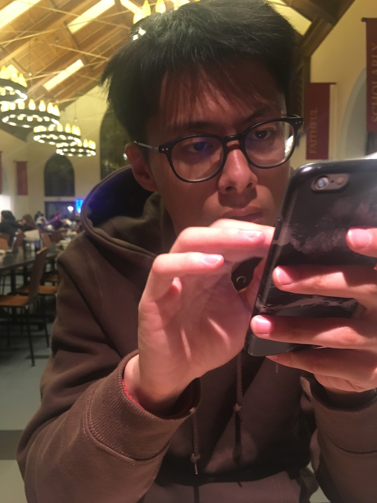
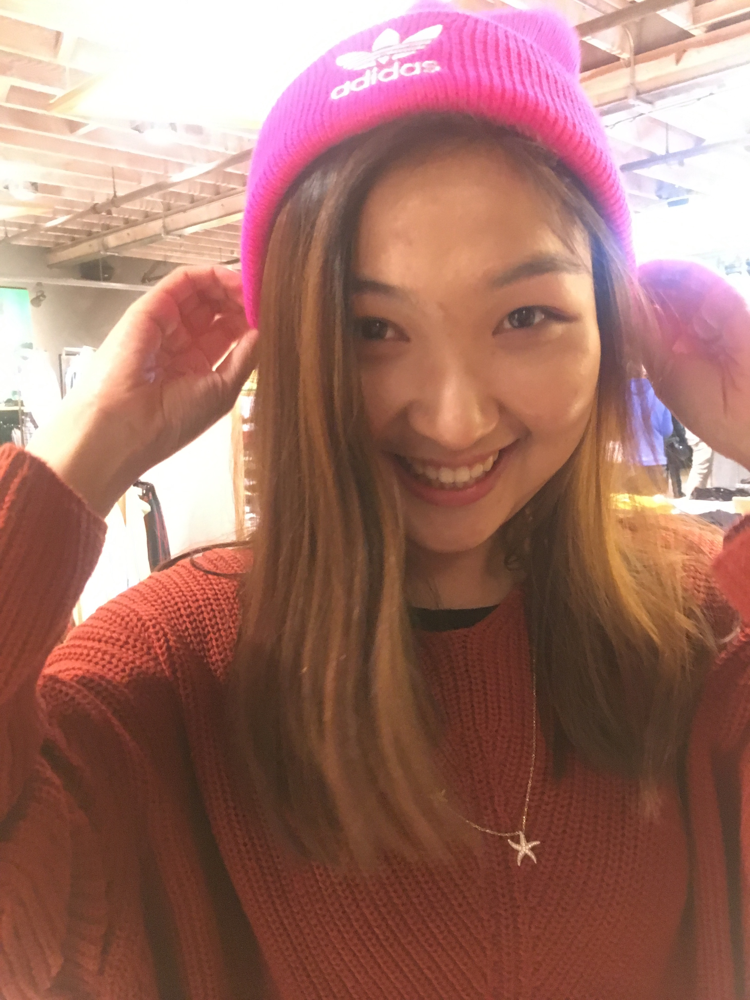
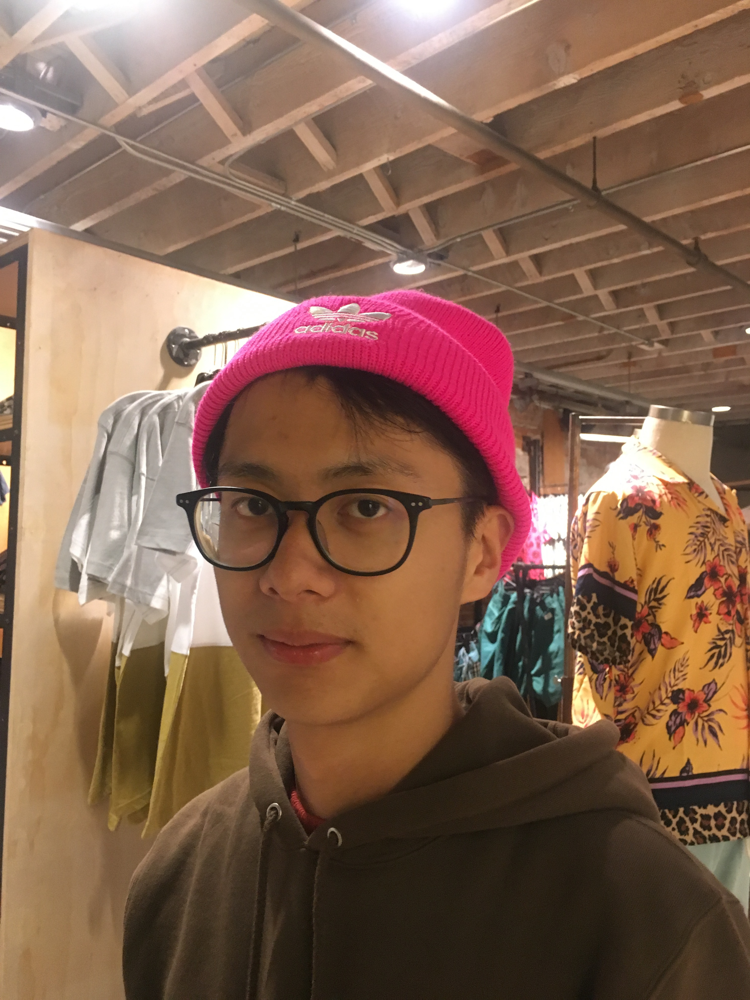
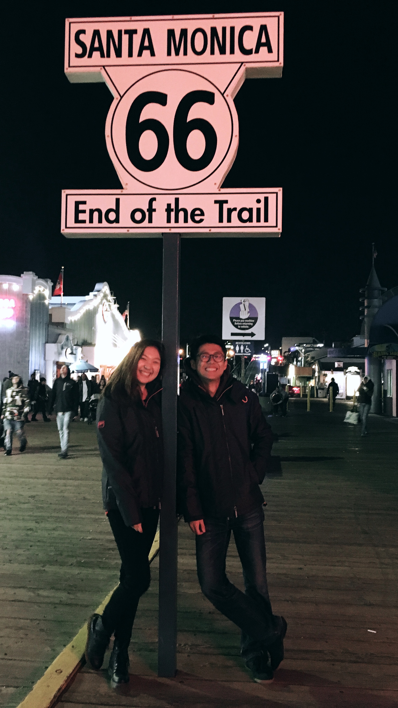
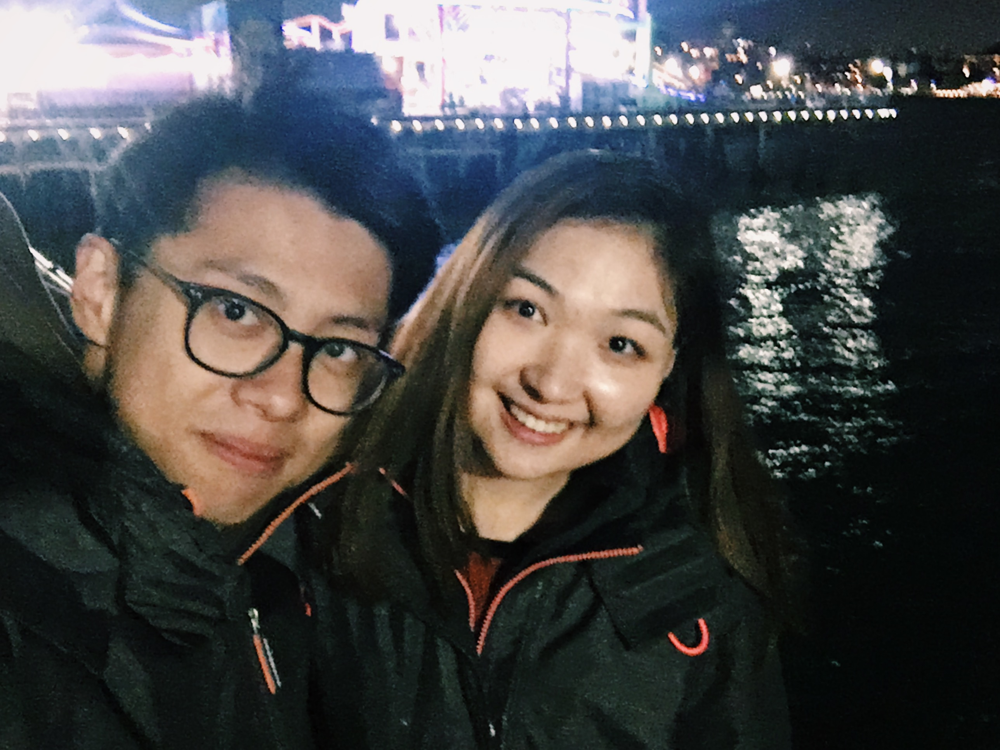
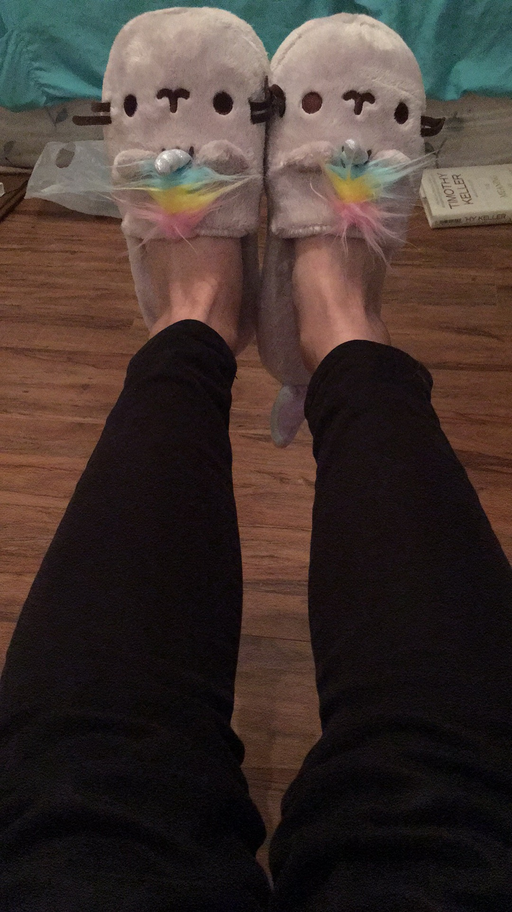

我们在一起已经一百天啦！！！真的不敢相信我和小冷已经在一起这么久了，虽然我们糊涂到从什么时候开始算起都不知道，但是我们真的已经在一起很久很久了，但是我还是觉得好短。好的感情是经得起考验的，我对我和小冷的感情很有自信，因为我们互相了解了这么久都把对方的小脾气摸的很清楚。就像每次我们想要跟对方说什么话但是对方却抢先说出来一样的感觉，我们之间的默契也越来约高，总之就是一切都很好。

我们在一起度过了很多个重要的时刻。从圣诞节平安夜，新年，到在洛杉矶小冷的生日和刚刚过去的春节和情人节，我能真真实实地感受到有一个人在旁边和你分享快乐的那种喜悦。我想在过去我从来没有在意过这些东西的存在的意义，但是因为小冷我开始期待它们的到来，我想这就是对生活有了更多的期待。

*我在食堂焦虑的搜索洛杉矶的晚上约会的地方，小冷坐在对么焦虑的拿着手机偷拍我*

我其实一直担心我自己没有办法管理好一段感情，因为我觉得自己很难控制好自己的情绪，但是后来我发现自己有能力改变自己。其实两个人在一起很重要的一点就是管理自己的负面情绪，而对方要学会如何对待这些负面情绪。没有人是完美的，都会有自己对事情不积极的一面，所以有的时候情绪不小心倾泻出来其实并不是有意为之，而更多的是对事情感性的认识。如果宽容不是两个人在一起意识到的第一个需要准备的事情，往往在以后的日子里会过得很累，也没有办法形成很多的默契。这种宽容也会让自己学会控制自己的情绪。我以前一直以为控制自己情绪是一件主动，非客观的事情，但是当我真的体会到两个人在一起之后的感觉，我发现实际上是从宽容开始的。人是有弱点的，就是不能从自己身上看清楚自己的问题的严重性，因为是主观的情绪。但是当你知道对方是如何感受到自己的弱点的时候，你就会意识到改变自己的重要性，实际上就是换位思考。在我这段刚刚开始的感情里，我觉得可以意识到这一点真的很幸运。

*在Urban Outfitter和小冷找到的一只粉色的帽子，感觉洛杉矶每天怕是都是要过冬天*

时间的长短我越来越觉得无所畏惧，而更多的是在一起的那种确定性。我是一个很需要时刻确定对方的感情的人，因为之前的经历告诉我不确定的感情是很岌岌可危的。但是这其实是一种不自信的表现，这样同时会给对方无形的压力。我有的时候看到小冷的眼神不太对我都会问她很多话，但是其实真的没有严重的问题。很感谢小冷可以耐心的跟我说她内心的想法，我也相信我会变得比以前更加自信。

*在Santa Monica的66号公路的路标的合影，不知道为什么两个人一直大笑*

*本来想照后面的摩天轮，但是却只照到了SuperDry的外套，真的是SuperGa + SuperDry = 超级超级尴尬组合*

有的时候还是会很在意身处的环境，因为毕竟是一个很能够影响自己情绪的因素，但是我并不觉得这是阻止两个人感情发展的屏障。每一次听到别人的质疑或者不满我们应该反而更加坚定不移，因为面对真实的自己一定是和环境有冲突的，所以会有人隐藏，但是那样永远不会是最好的解决方法。实际上这也是一种不自信的表现，但是我们完全没有必要，因为我们的自信应该来源于自己和对方，而不是来自于别人的认可。我一直认为我是一个内心强大的人，小冷也是，所以我们在未来也会越来越好。

*少女心爆棚的小冷买了一双超级cute的毛茸茸的不会动的毛的拖鞋，回到家之后激动地给我发照片*

至于未来，虽然我一直认为所有事情都是随缘的，但是我觉得除了小冷应该不会在有第二个人出现了。没有人可以像另外一个自己一样这么了解自己，我觉得应该，不对，是肯定就是她了。

--Haoyang
