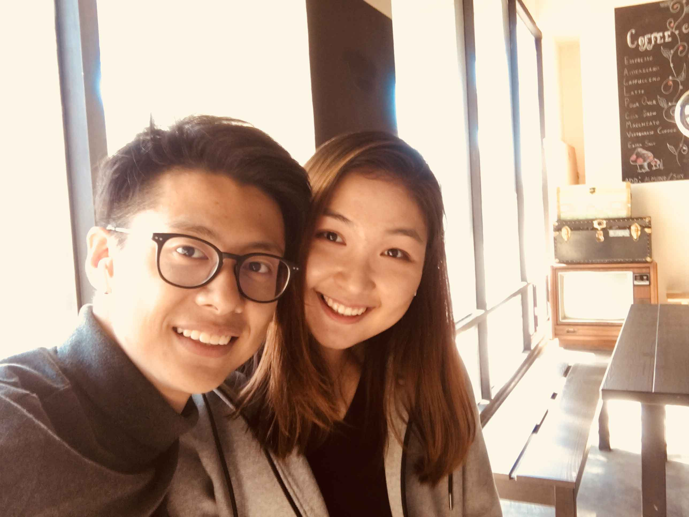
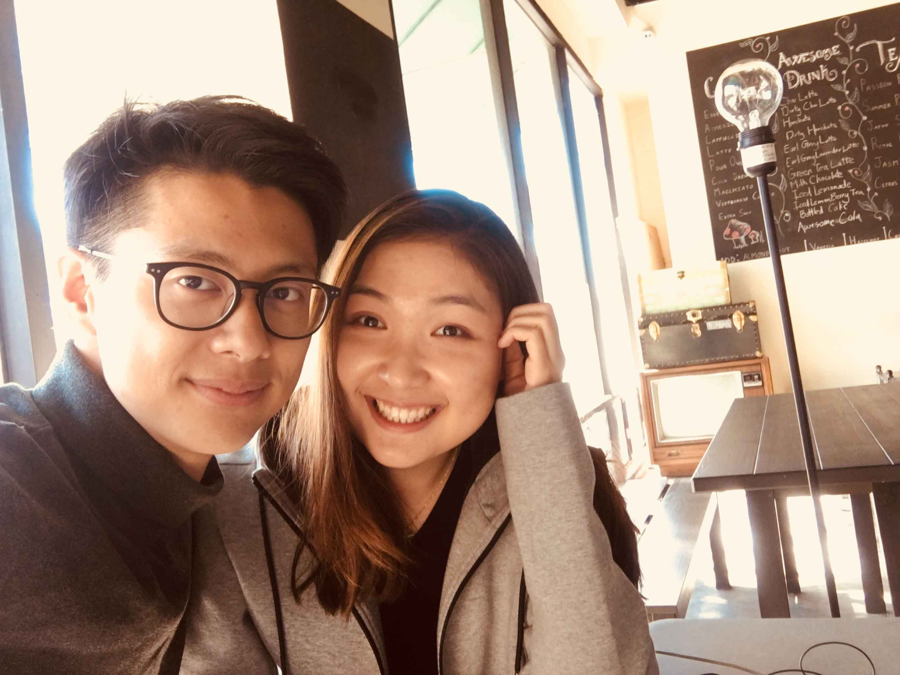
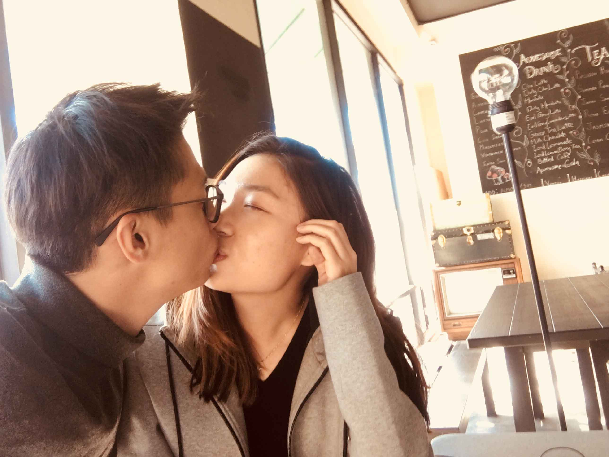
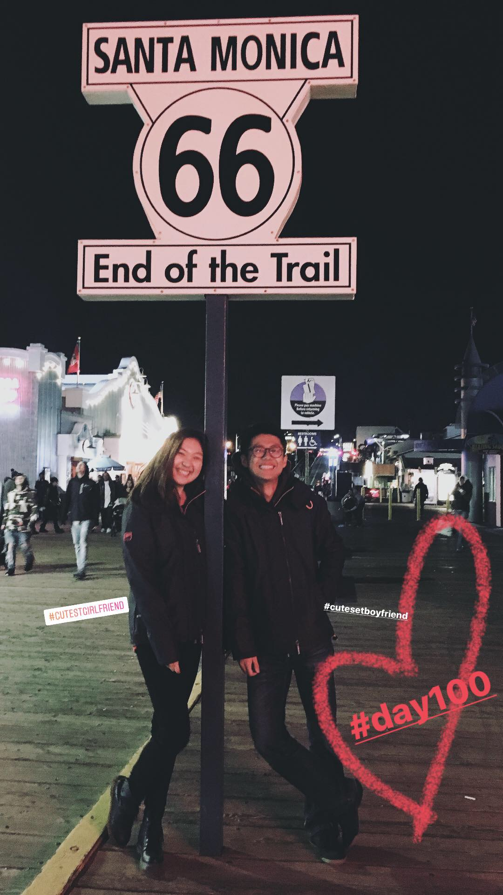

我之前说感情是有趣的，这种有趣来源于不确定感，不确定感起源于那个未知的人。当未知变成已知，不确定感就不再是让人渴望的。我们寻找着给予着安稳和真实的幸福感。

我一直都相信，爱情应该是每个人人生中的必修课，从某种意义上讲，这远比得到一张大学毕业证书更珍贵更长久。在一段感情里，我们的弱点，我们的负面情绪会很快失去它们的藏身之处，我们的情绪控制和换位思考的能力会一次又一次地被挑战。刚开始的一个多月里，我很惶恐，我频繁的情绪波动和过分活跃的眼泪，都让我担心peter招架不住也无法接受这样的我。但他真的很好很好，他总是给我一个绝对安全的环境表达自己所有的情绪，他不冷漠不忽视，他不会跟我讲很多很多的大道理，因为他知道我都能想明白，他会认真地听，会紧紧地抱着我，告诉我他一直都在。在我不安的时候，他会在我耳边跟我说很多很多他平时不好意思告诉我的话，嘿嘿嘿还会以提前透露惊喜为代价。

*Peter&Leng*

走到100天，我终于到了一个很好的状态，我们也终于到了一个很稳定很幸福的状态。我还是会在焦虑的时候皱眉头，但我会跟他讲给我一点点时间，我一会儿就好；在他写不出代码不太搭理我的时候，我还是会有点不开心，但我越来越能换位思考，会给他时间自己调整；我还是会很多乱七八糟的小情绪，他也还是有一些自己偷偷乱想的时刻，但是我们养成了一个很可爱的小习惯 :). 我们会讲“悄悄话”，把我们的小想法都变成悄悄话偷偷地讲给对方听，我们默契地知道，悄悄话是需要对方绝对宽容和理解的，是需要一个大大的拥抱鼓励的！

*在Awesome Coffee*

Peter会说我是一个很有少女心的大姑娘哈哈，但其实我一直都不知道少女心的定义 :(. 可是我就是很喜欢去很漂亮的咖啡厅学习聊天，在挂着很多灯的街上走路，在海边吹风，站在街边听人弹吉他唱歌，偶尔偶尔“偷偷”吃一次很喜欢但又不敢吃太多的甜点，在超市的零食区徘徊二十分钟疯狂自言自语说这个很好吃，那个也很好吃然后什么都不买。从前我会自己笑自己真的是一个很奇怪的姑娘，我妈也会在我看了十次巧克力但就是不买的时候说 “这个孩子到底是怎么回事儿”。可现在呢，我的生活就更有意思了！因为有一个人陪着我做所有我想做的事情嘿嘿，他会点一个我很想吃的甜点，然后说不是给我的哦，但基本上都是我吃掉四分之三 :(； 他会在一个月里陪我explore了六七家咖啡馆；他看见好看的小男生的时候会叫我快看啊哈哈哈；他会在过马路的时候叫我快跑；他总是笑我的生活里充满着“意外”，不过现在他也是哼哼！

*听The Simple Things*

最幸福的事情大概就是你生命中未知的那个人变成了已知，然后你万分渴望和这个已知的人一起探索你们未知的未来，碰巧，他也是。

*We are the Cutest Couple*

--最可爱的小姑娘
