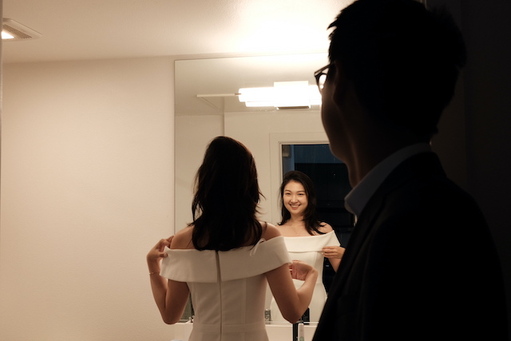
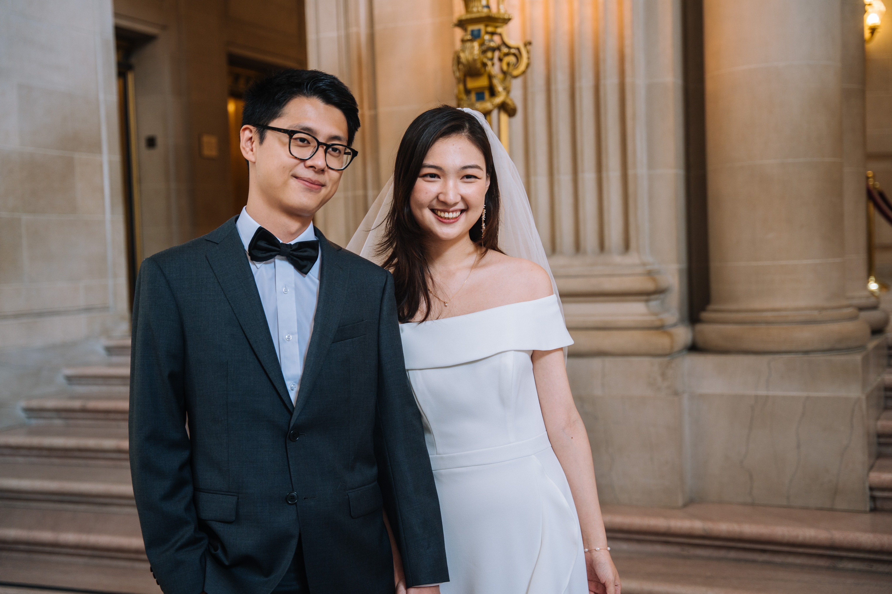

彼得曾经说我照亮了他的生活，但其实他才是那个治愈我的人。

很多朋友最初认识我，都觉得我活的很幸福很轻松，应该是个在很有爱的家里长大的小孩。但其实我的原生家庭并没有很幸福，从很小的时候，我就知道母亲对父亲有很多的抱怨和不满，她不是一个能藏事儿的人，很多时候这些情绪她都传递给了我。到今天为止，母亲还是会说这段婚姻带给她唯一的收获和礼物就是我。小时候不懂，后来慢慢成长，慢慢懂得，母亲无心的话语和情绪其实给了我很多压力，我害怕做错，我害怕让她失望，我甚至认为过我是那个害她困在这段婚姻里的人。我与父亲也慢慢疏远，不知道怎么与他交流，可能因为从母亲那里听来太多他的“不是”，我甚至也开始对他有些些埋怨和不满。直到 15 年夏天，他生了一场大病，那种即将失去他的恐惧感让我意识到，身为我的父亲，他其实付出了很多。从前我好像都选择了视而不见。

*在去旧金山之前朋友记录我们试衣服*

我走了很长的路，花了很长的时间，才慢慢学会和自己和解。我知道自己并没有做错什么，我也不应该背负什么，但或许不快乐的童年真的需要很长的时光去治愈。很多年过去，尽管我的内心越来越强大，我越来越了解自己，但还是逃不过那些突然难过的时刻，逃不过那些早上醒来还得缓一缓的梦。

我可能和很多父母婚姻不幸福的人不太一样，我知道很多人因此不相信婚姻，不愿意和另一个人许诺一生，但我从很早就坚定地知道我一定会结婚，我会和一个很好的，我很爱的人结婚。我们会有一个幸福的家，这个家里是可以好好沟通的，是充满爱的，是会被宽容被理解的。我想给我自己一个机会，拥有一个幸福的家的机会。现在的我真的很幸福，因为我做到了。我遇到了那个很好的人，我很爱他，我也知道他很爱我。然后，我们有了一个家。

是什么时候想要跟彼得结婚的呢？是我发现不管发生什么，再慌再乱，他都不会指责埋怨我；在面临人生选择的时候，他说的话总是，“选择对你自己最好的，剩下的事情我们一定有办法解决”，就算有很多不确定，甚至我都有些动摇了，他好像也从来没想过分开这个选项；是不管我想做什么，他都会说“你能做让自己高兴的事情就是最好的”；是我发现我的喜好慢慢变成了他的喜好；是我发现他的电脑桌面上有个命名为”小冷“的文件夹；是我发现在机场道别的时候我忍不住的眼泪；是我发现在我对于未来所有的美好构想里，他都是那个主角；是我发现只要和他呆在一起，我很少难过，我很少回忆过去；是我发现我愿意让他知晓我所有的脆弱；是我发现我终于可以坦然地对他说出我对于父母关系的纠结与不安，童年时的那些不快乐。好像在他眼里，我不需要当一个完美的人，我只需要当一个快乐的人。

*在市政厅*

看着他的眼睛说“I do”的那一刻，很多情绪涌上心头，但最多的还是感谢。感谢这五年来我俩都从未想过放开对方的手，感谢他对爱情的执着和信任，感谢我自己仍旧相信婚姻，感谢我们未来还有很多很多年一起走… 我和他终于变成了我们。
