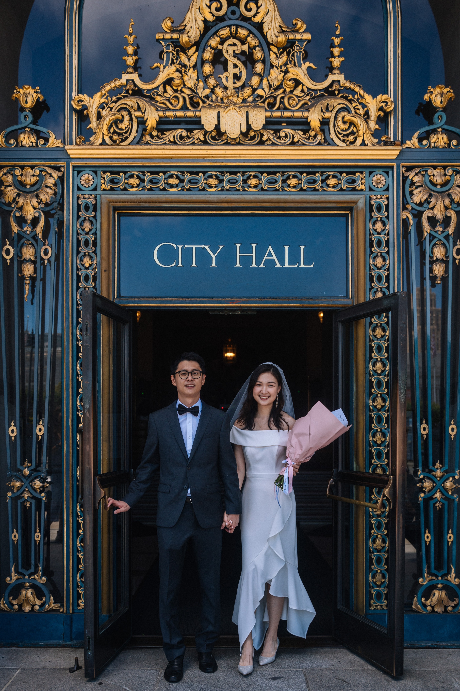
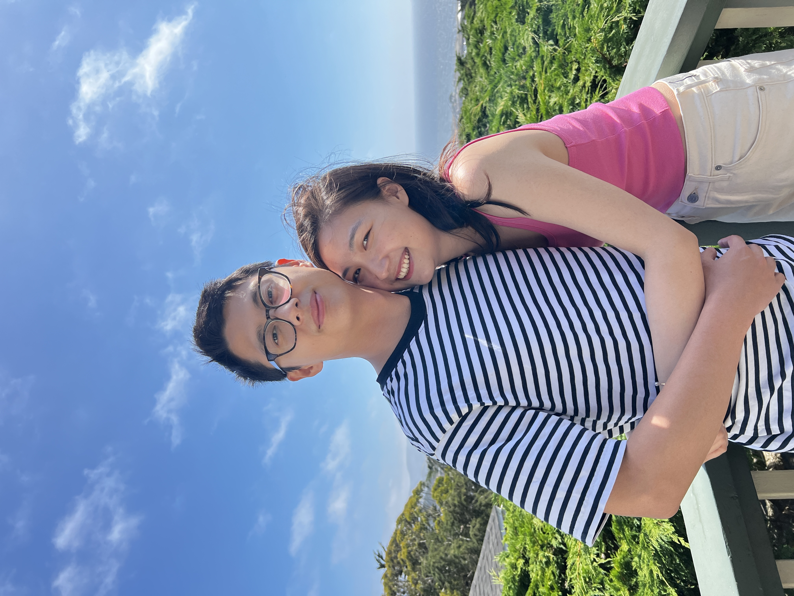

7月13号我们在旧金山市政厅结婚了！一直想找一个时间给你写一封信，可惜一直没有机会，现在在从圣路易斯回家的飞机上，想和你说说我的心里话。

这个博客记录了我们从初识到恋爱，记录了从各种不确定到逐渐稳定的一段感情，我很感谢过去的自己可以把这些美好的瞬间记录下来，我更感激我遇到了一个美好的人。

*在市政厅*

前几周黄翰文找我吃饭，他一直问我为什么选择了你而不是别人。他觉得结婚意味着一起买房，一起赚钱，而你似乎这些都不满足，那我为什么要选择你呢？我说小冷带给我的东西比你说的要更加的有价值，而且无法用金钱衡量。记得刚来usc读书的时候我选了trojan hall，因为我当时天真的想离开自己的小圈子，认识新的朋友。但是这也是我第一次真正的来美国长期生活，我完全高估了自己。从高中的时候我就不是一个有很多朋友的人，因为我害怕自己做的不好，害怕自己被别人嘲笑，所以我甚至是一个很古怪的人。来到了一个新环境只会让我变得更加奇怪和不适应。让我走出来变自信的人是你。

你在芝加哥读书的时候，也是我刚从nyu毕业的时候在找工作的时候，也是新冠刚刚开始爆发的时候。当时国内的公司其实已经给我发了offer，但是是你提醒我我内心其实最想要的是什么。我想你可能连你自己都没有意识到，其实是你让我变成了一个即使在逆境中也坚定不移的人。

*Pacifica附近的一座山上*

还记得我刚来湾区的那段时间吗？刚到这里我突然意识到未来就只有我一个人在这里生活让我完全无法接受。后来几个星期后我一个人在家抑郁到预约了心理咨询师，因为当时甚至有了自杀倾向，当然这些我其实都没跟你说过。还记得心理咨询师在治疗结束后问我为什么会想到联系她而不是轻生，我说是因为我的女朋友告诉我永远不要放弃自己。

如果换做别人，我想一定不会这么耐心的鼓励我，给我打气，不放弃我。我很感谢我遇到了小冷。

我现在依旧还是个不完美的人。在和朋友聚会的时候不知道怎么介绍大家，在闹变扭的时候总是很固执，在做一些决定的时候还是不够坚定。但是对于你，我确定你就是那个对的人，是那个完美的人，也是可以让我变得更好的人。

作为结婚之后的承诺，我认为永远不应该是一个人付出，而应该是两个人共同努力，互相打气。在这里我们虽然无依无靠，但是我们拥有彼此。我认为一段真挚的感情是未来不管是物质还是精神的基础。我很清楚未来还有很多的不确定，但是这些不确定只会让我们更加珍惜彼此，我永远会记得为你戴上戒指的那一刻，因为从此我们永不分离。
